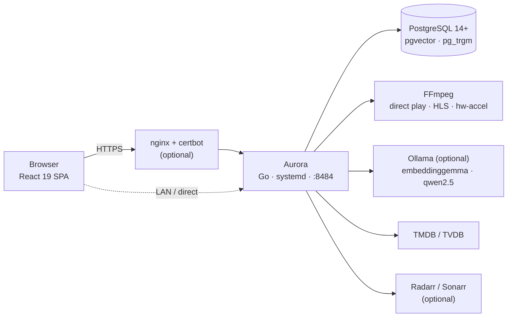

<div align="center">


**The self-hosted media server that installs in one command and streams better than any subscription!**

<br>


<br><br>

[Install](#-install) · [Features](#-what-you-get) · [Semantic search](#-enabling-semantic-search-ollama) · [Configuration](#configuration) · [Updating](#-updating) · [Troubleshooting](#-troubleshooting) · [Development](#development)

</div>

---

Aurora is a media server written in Go with a React single-page app on top. It scans your movie and TV folders, matches them against TMDB, and streams to any device with a browser — direct play when the codecs allow it, hardware-accelerated FFmpeg transcoding when they don't. It runs bare-metal on Linux (systemd + native PostgreSQL): no Docker, no external services required, and everything — including the optional AI features — stays on your box.

## ✨ What you get

### 🎬 Streaming that gets out of the way
- **Direct play** over HTTP range requests, with **HLS transcode fallback** via FFmpeg
- **Hardware acceleration** auto-detected per host: NVENC, QSV, VAAPI, AMF
- **Smart Skip** — automatic intro & credits detection (sandboxed analysis workers), one tap to skip
- **Subtitles** — embedded tracks extracted to WebVTT, plus external SRT/VTT discovery
- **Casting** — AirPlay-compatible casting with codec-aware remuxing and secure cast tokens
- **Continue watching** — per-user resume positions, auto-complete at 90%

### 🎉 Watch together
- **Watch parties** with synchronized playback, live chat, reaction overlays, and WebRTC voice
- **QR / link invites** to pull friends into a room in seconds
- Admin **Rooms** panel to see and manage active parties

### 🧠 AI, running locally (optional)
- **Semantic search** — describe what you want in plain English; pgvector embeddings + a local chat model turn it into results, with classic trigram search as the always-on fallback
- **AI file matching** — uncertain filename→metadata matches get flagged into an admin review queue instead of silently mis-filing
- **Personalized home** — hero picks and discover rows tuned by your watch history, with a taste-onboarding flow for new accounts
- **Catch Me Up** — episode recaps so you can rejoin a show without rewatching
- All of it runs on **your** hardware through [Ollama](https://ollama.com) — no cloud calls, and Aurora works fine with it switched off

### 📚 A library that stays organized
- Multi-path libraries with **filesystem watching** and scheduled auto-scans
- **TMDB** metadata (movies + TV) with **TVDB** fallback — cast & crew, artwork, blurhash placeholders
- **Collections**, a release **Calendar**, **My Library**, and a ⌘K **search palette**
- Per-user **profiles** with avatars

### 📥 Requests
- End-user request flow backed by **Radarr / Sonarr** (including separate 4K instances)
- Approval workflow with request progress tracking

### 🛡️ Built to be operated
- **Auth**: cookie-based JWT + refresh tokens, Argon2 hashing, invite codes, rate limiting, **Google & GitHub OAuth** account linking
- **Admin dashboard**: users & roles, activity log, live transcode sessions, flagged-match review, logs, server panel, LLM settings, OAuth config, notifications
- **Backup & restore** built into the admin UI (`pg_dump` under the hood)
- **Auto-updater**: a 5-minute systemd timer plus an in-app **Update Now** button; optional signed-commit verification before anything is built as root
- **Hardened systemd unit**: `NoNewPrivileges`, `ProtectSystem=strict`, `ProtectHome=read-only`, dedicated unprivileged `aurora` user
- **In-app bug reporter** (optional) that files GitHub issues with a screenshot or 30-second screen recording — see [`docs/bug-report-setup.md`](docs/bug-report-setup.md)

## 🚀 Install

One command on a fresh Debian / Ubuntu / Fedora / RHEL / Arch / openSUSE box:

```bash
git clone https://github.com/ronniekai999/AuroraPro.app
cd AuroraPro.app
sudo ./scripts/install.sh
```

The installer takes care of **everything**: the Go toolchain (with checksum verification against Go's official release index), FFmpeg, PostgreSQL + pgvector + pg_trgm, the `aurora` system user, the systemd unit, database role + schema, JWT secret generation, the frontend + backend build, and the auto-updater timer.

You'll be prompted once for:

- **TMDB API key** — free at [themoviedb.org/settings/api](https://www.themoviedb.org/settings/api)
- **Media directory** — the folder(s) Aurora should read (see [permissions](#-media-folder-permissions) below)

It ends with a health check, a schema verification, a semantic-search preflight, and the URL to open. Re-runs are **idempotent** — your JWT secret, database, and configuration are preserved.

### Unattended install

```bash
sudo TMDB_API_KEY=xxxxx \
     AURORA_MEDIA_DIR=/srv/media \
     ./scripts/install.sh
```

### Opt-in extras

| Env var | What it does |
|---------|--------------|
| `AURORA_MEDIA_DIR=/path[,/path2]` | Grants the `aurora` user read access to your media (comma-separated for multiple paths) |
| `AURORA_DOMAIN=media.example.com` | Sets up nginx reverse proxy + Let's Encrypt HTTPS |
| `AURORA_CERTBOT_EMAIL=you@example.com` | Required if `AURORA_DOMAIN` is set |
| `AURORA_INSTALL_OLLAMA=1` | Installs [Ollama](https://ollama.com) and pulls the semantic-search models (`embeddinggemma` + `qwen2.5:3b-instruct`, ~2.5 GB total) |
| `AURORA_RADARR_URL=` + `AURORA_RADARR_API_KEY=` | Enables movie requests via Radarr |
| `AURORA_SONARR_URL=` + `AURORA_SONARR_API_KEY=` | Enables TV requests via Sonarr |
| `AURORA_TVDB_API_KEY=` + `AURORA_TVDB_PIN=` | TVDB metadata fallback |
| `AURORA_GIT_TOKEN=<PAT>` | **For private repos** — writes `/root/.git-credentials` (mode 600) so the auto-updater can `git fetch` non-interactively. Use a fine-grained PAT scoped to `Contents: Read-only` on just this repo. |

### 📂 Media folder permissions

Aurora runs as the unprivileged `aurora` system user. Home directories default to `0700`/`0750` on modern distros, so a path like `/home/you/media/movies` that *you* can see is often **invisible to the service** — the Libraries form will tell you exactly that if it happens. Grant access the easy way (works any time, not just at install):

```bash
sudo AURORA_MEDIA_DIR=/home/you/media ./scripts/install.sh
```

or manually with ACLs:

```bash
sudo setfacl -m u:aurora:x /home/you                    # traverse each parent
sudo setfacl -R  -m u:aurora:rX /home/you/media          # read the media tree
sudo setfacl -dR -m u:aurora:rX /home/you/media          # new files inherit access
```

Storing media outside `/home` (e.g. `/srv/media`) avoids the issue entirely. Note the systemd unit mounts `/home` **read-only** for Aurora — it can scan and stream your files but never modify them.

## 🧠 Enabling semantic search (Ollama)

Semantic search is on by default but needs a local [Ollama](https://ollama.com) with two models. Either install with `AURORA_INSTALL_OLLAMA=1`, or at any time:

```bash
curl -fsSL https://ollama.com/install.sh | sh
ollama pull embeddinggemma          # 768-dim embeddings (CPU-friendly)
ollama pull qwen2.5:3b-instruct     # query parsing / reranking
sudo systemctl restart aurora
```

The installer writes `LLM_OLLAMA_URL=http://localhost:11434` into your config and every install run ends with a **preflight** that tells you whether Ollama is reachable and the models are pulled. Without Ollama, search quietly falls back to keyword/trigram matching — everything else works. Set `LLM_ENABLED=false` to switch the AI stack off explicitly.

<a id="configuration"></a>
## ⚙️ Configuration

Config lives at `/etc/aurora/aurora.env` (written by the installer, preserved across re-runs). Edit and `sudo systemctl restart aurora`.

| Key | Purpose |
|-----|---------|
| `DATABASE_URL` | PostgreSQL connection string |
| `JWT_SECRET` | Session signing secret (auto-generated; keep private) |
| `TMDB_API_KEY` / `TVDB_API_KEY` + `TVDB_PIN` | Metadata providers |
| `LLM_ENABLED` | AI stack on/off (default on) |
| `LLM_OLLAMA_URL` | Ollama endpoint (installer pins `http://localhost:11434`) |
| `LLM_EMBED_MODEL` / `LLM_CHAT_MODEL` | Model overrides (defaults: `embeddinggemma`, `qwen2.5:3b-instruct`) |
| `REQUESTS_ENABLED` + `RADARR_URL`/`RADARR_API_KEY`, `SONARR_URL`/`SONARR_API_KEY` | Requests integrations |
| `AURORA_ALLOWED_ORIGINS` | CORS / WebSocket origins (same-origin always allowed) |
| `CACHE_IMAGE_DIR` / `CACHE_TRANSCODE_DIR` / `CACHE_SUBTITLE_DIR` | Cache locations |
| `LOG_DIR` / `LOG_LEVEL` | Logging |
| `AURORA_SOURCE_DIR` / `AURORA_UPDATE_BRANCH` / `AURORA_EXPECTED_REMOTE` | Auto-updater source (root-owned mirror) |
| `AURORA_UPDATE_REQUIRE_SIGNED` + `AURORA_UPDATE_ALLOWED_SIGNERS` | Require verified commit signatures before the updater builds as root |

**On disk:** binary at `/usr/local/bin/aurora` · app + static + migrations at `/opt/aurora` · cache at `/var/cache/aurora` · logs at `/var/log/aurora` + journald · state + source mirror at `/var/lib/aurora` · listens on port **8484**.

```bash
systemctl status aurora           # current state
journalctl -u aurora -f           # follow logs
systemctl restart aurora          # restart after a config change
```

## 🔄 Updating

**Automatic** — `aurora-update.timer` checks your origin every 5 minutes and does `git fetch` → rebuild → atomic swap → restart → health check, with automatic rollback to the previous binary if the new one fails its health check. Admins can also hit **Update Now** in the UI (Server tab), which triggers the same pipeline through a systemd path unit — no sudo involved.

```bash
systemctl status aurora-update.timer
journalctl -u aurora-update -n 50
```

**Manual rebuild** from a local checkout (faster than waiting for the tick, or when applying local changes):

```bash
cd <your-aurora-clone>
git pull
./scripts/redeploy.sh        # build SPA + Go binary, atomic-swap, restart
```

Use `--skip-npm` to reuse an existing frontend build, `--no-restart` to stage without bouncing the service.

**Reinstall** when an update touches `scripts/install.sh` itself (new state dirs, systemd unit changes):

```bash
cd /var/lib/aurora/source
sudo git pull
sudo ./scripts/install.sh
```

**Private repos**: the updater needs credentials to fetch — provide `AURORA_GIT_TOKEN` at install time. **Supply-chain hardening**: set `AURORA_UPDATE_REQUIRE_SIGNED=true` (plus a signing key / allowed-signers file) and the updater refuses to build anything without a verified commit signature.

## 🩺 Troubleshooting

| Symptom | Cause & fix |
|---------|-------------|
| Adding a library says **“the Aurora service user cannot access …”** | The `aurora` user can't traverse into your (mode `0700`/`0750`) home directory. Run `sudo AURORA_MEDIA_DIR=/path ./scripts/install.sh` or the [`setfacl` commands above](#-media-folder-permissions). |
| Adding a library says **“path does not exist on the server”** | The path must exist on the **server's** filesystem — check `ls -ld <path>` on the box, watch for typos. |
| Installer fails at **“Could not obtain a valid SHA-256”** for Go | go.dev's checksum endpoints occasionally serve HTML redirect pages. Re-run to retry, or `apt install golang` (any Go ≥ 1.26) and re-run — the installer accepts a pre-installed toolchain. |
| **Search feels keyword-only / embeddings missing** | Ollama isn't reachable or models aren't pulled. The install summary's semantic-search preflight prints the exact commands; see [semantic search](#-enabling-semantic-search-ollama). |
| Service won't start, log shows **migration 014** failing | pgvector isn't installed/visible. Re-run the installer (it installs pgvector and pre-creates the extension); if a stale row remains: `sudo -u postgres psql aurora -c "DELETE FROM schema_migrations WHERE version='014_semantic_search.up.sql';"` then restart. |
| **Port 8484 already in use** | `sudo ss -tlnp \| grep 8484` and stop the conflicting process (or move it). |
| Updater log spams **“could not read Username for github.com”** | Private repo without credentials — re-run the installer with `AURORA_GIT_TOKEN=<PAT>`. |

## 🏗️ Architecture



A single Go binary serves the API, WebSockets (live scan progress, watch parties), and the built SPA. PostgreSQL holds the catalog with pgvector for embeddings and pg_trgm for fuzzy search. FFmpeg handles transcoding with per-host hardware-acceleration detection. Everything optional degrades gracefully when absent.

## 📦 Requirements

- **OS**: Linux with systemd (Debian/Ubuntu, Fedora/RHEL, Arch, openSUSE) — bare metal, no Docker in this repo
- **Disk**: ~500 MB for binary + cache + Go toolchain, plus your media; ~2.5 GB more if you enable the local AI models
- **RAM**: 1 GB minimum; 4 GB recommended with the local LLM enabled
- **PostgreSQL**: 14+ (installed automatically)

## 🧹 Uninstall

```bash
sudo ./scripts/uninstall.sh           # interactive, asks before each step
sudo ./scripts/uninstall.sh --force   # skip prompts (for automation)
```

Removes the binary, systemd units, config, cache, source clone, database, and the `aurora` user. Shared packages (PostgreSQL, FFmpeg, Go, nginx, certbot) are left in place.

<a id="development"></a>
## 🛠️ Development

```bash
go build ./...     # must be green
go test ./...      # must be green
```

- Branch off `main`; never commit to `main` directly. The pipeline (research → implement + tests → adversarial review → merge gate) is documented in [`docs/dev-workflow.md`](docs/dev-workflow.md).
- Testing a change against a live server end-to-end: [`docs/server-testing.md`](docs/server-testing.md) (`scripts/server-test-loop.sh`).
- Manual reverse-proxy configs (Caddy + nginx): [`docs/reverse-proxy/`](docs/reverse-proxy/).
- Frontend lives in `static/redesign/app` (React 19 + Vite 7 + TypeScript).

## 📄 License

Personal-use license — contact the maintainer for anything beyond personal use.
