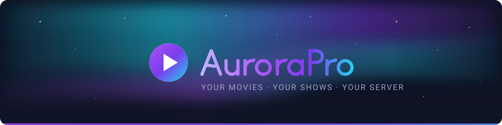
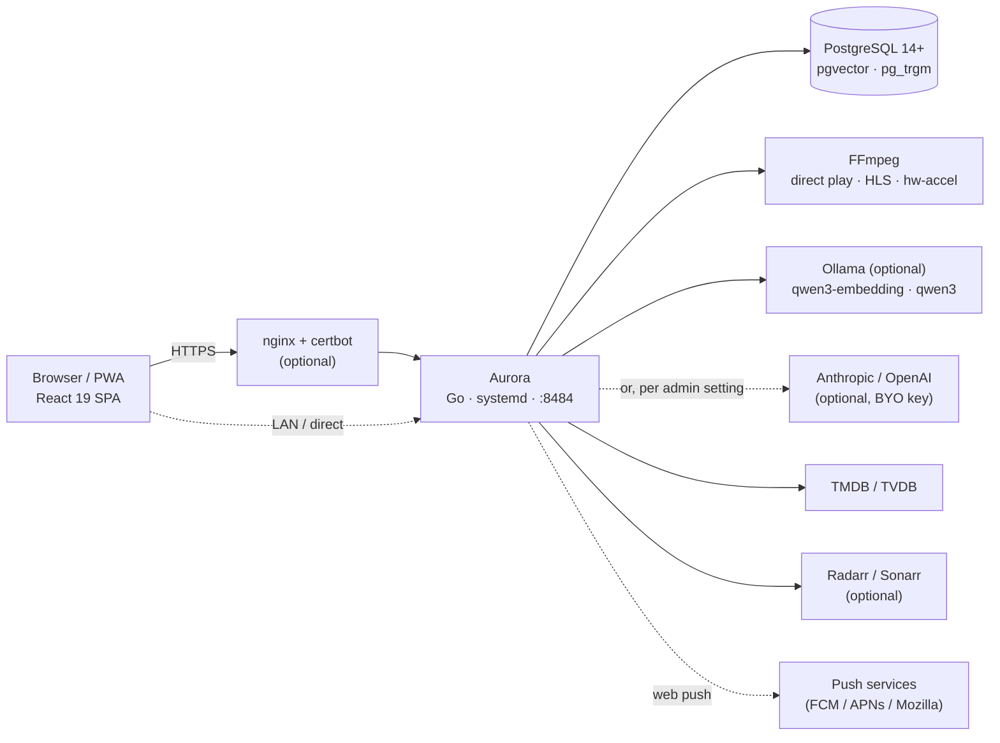

<div align="center">



**The self-hosted media server that installs in one command and streams better than any subscription!**

<br>


<br><br>

[Install](#-install) · [Features](#-what-you-get) · [Semantic search](#-enabling-semantic-search-ollama) · [Configuration](#configuration) · [Updating](#-updating) · [Troubleshooting](#-troubleshooting) · [Development](#development)

</div>

---

Aurora is a media server written in Go with a React single-page app on top. It scans your movie and TV folders, matches them against TMDB, and streams to any device with a browser — direct play when the codecs allow it, hardware-accelerated FFmpeg transcoding when they don't. It runs bare-metal on Linux (systemd + native PostgreSQL): no Docker, no external services required, and everything — including the optional AI features — stays on your box.

## ✨ What you get

### 🎬 Streaming that gets out of the way
- **Direct play** over HTTP range requests, with **HLS transcode fallback** via FFmpeg
- **Hardware acceleration** auto-detected per host: NVENC, QSV, VAAPI, AMF — including **HEVC output** on capable encoders (`hevc_nvenc`/`_qsv`/`_vaapi`/`_amf`, `libx265` in software) for clients that can decode it
- **Smart Skip** — automatic intro & credits detection (sandboxed analysis workers), one tap to skip
- **Subtitles** — embedded tracks extracted to WebVTT, plus external SRT/VTT discovery
- **Casting** — AirPlay-compatible casting with codec-aware remuxing and secure cast tokens
- **Continue watching** — per-user resume positions, auto-complete at 90%

### 🎉 Watch together
- **Watch parties** with synchronized playback, live chat, reaction overlays, and WebRTC voice
- **QR / link invites** to pull friends into a room in seconds, plus **member invites** you can send now or **schedule** — RSVP from the notification bell, a lobby countdown, and the booking shows up as a chip on the Calendar
- **Host succession** — the party survives its host leaving, and scheduled parties survive a server restart
- **Highlight reels** — the most-reacted moments auto-exported as a shareable MP4
- **Phone as second screen** — a mobile companion at `/join` for chat, reactions, and voice without a video player
- Admin **Rooms** panel to see and manage active parties

### 🧠 AI, local or bring-your-own-key (optional)
- **Semantic search** — describe what you want in plain English; pgvector embeddings + a chat model turn it into results, with classic trigram search as the always-on fallback
- **AI file matching** — uncertain filename→metadata matches get flagged into an admin review queue instead of silently mis-filing
- **Personalized home** — hero picks and discover rows tuned by your watch history, with a personal **Match %** on each pick and a taste-onboarding flow for new accounts
- **Catch Me Up** — episode recaps so you can rejoin a show without rewatching, plus **Ask Previously**: spoiler-bounded follow-up questions about the show so far
- **Star ratings** — per-profile 1–5★ verdicts that steer the recommender directly (4–5★ pulls your taste toward a title, 1–2★ excludes it and its lookalikes)
- Runs on **your** hardware through [Ollama](https://ollama.com) by default — no cloud calls — or plug in an **Anthropic (Claude)** or **OpenAI (ChatGPT)** API key to run the same features on hosted models. Aurora works fine with all of it switched off

### 📚 A library that stays organized
- Multi-path libraries with **filesystem watching** and scheduled auto-scans
- **TMDB** metadata (movies + TV) with **TVDB** fallback — cast & crew, artwork, blurhash placeholders
- **Collections**, a release **Calendar**, **My Library**, per-profile **watchlists**, and a ⌘K **search palette**
- Netflix-style **sub-profiles** with avatars and per-profile subtitle/language preferences, plus a **parental age ceiling** and an optional per-profile **PIN**. The ceiling is enforced from the signed-in profile on library browse, Recently added, library search, title details and playback; applied to the recommendation rails, taste onboarding and the follow feed for whichever profile the app names; and checked against the invitee's default profile when a watch-party invite is sent. Among the surfaces it does not yet filter are Continue Watching, collections, watchlists, My Library, the calendar, watch history and the Home "Watch together" card of live and scheduled parties. A PIN locks switching into that profile (the account password also unlocks it); setting one signs out the account's other devices using that profile. A profile with a ceiling cannot manage profiles or change its own ceiling. Profile changes always leave an account one profile without a ceiling: giving the last one a ceiling, deleting it, or giving an account's first profile a ceiling is refused, so add a separate profile for a child rather than restricting a single-profile account. A password sign-in lands on the account's default profile without asking for its PIN (the password stands in for it), so don't save the account password in a browser a child uses; a sign-in through a linked Google, Discord or other account lands there only while it has no PIN, and otherwise on the most restrictive unlocked profile (with every profile locked it is refused, and the password signs in; on an account with no password, it lands on the most restrictive profile). Lock every profile whose limit is looser than a restricted one's (or that has none), or the restricted profile can still switch to it. On an admin account, a session using a restricted profile is refused the admin pages and the admin role's other powers (unless no profile on the account is free of a limit, when it keeps them so the server is not left without an admin), but it gets every one of them back, restoring a backup included, by switching to an unlocked profile without a limit, so lock every such profile; it also still sees the admin alerts (other members' requested titles, scan results). A separate account that is not an admin remains the safer home for children (gaps listed in [`CLAUDE.md`](CLAUDE.md))
- **XP, levels, streaks, and achievements** for the people who like a scoreboard

### 👥 Social
- **Member profiles** at `/user/:name` — bio, social handles, and (opt-in, off by default) recent watches
- **Follow** other members, browse the **`/members`** directory, and get a **"From People You Follow"** rail on the home page

### 📥 Requests
- End-user request flow backed by **Radarr / Sonarr** (including separate 4K instances)
- Approval workflow with request progress tracking

### 🛡️ Built to be operated
- **Auth**: cookie-based JWT + refresh tokens, Argon2 hashing, invite codes, rate limiting, and **OAuth sign-in / account linking** for **Google, Discord, Twitch, Facebook, and X (Twitter)** — each one separately enabled and configured in the admin UI, with a per-provider "skip the invite code" toggle
- **Installable PWA** — manifest + icons, and **web push** that reaches your devices with no tab open (request ready/failed, party invites & reminders, highlight reel ready, plus admin alerts for pending requests and completed scans). Zero configuration: the VAPID keypair is generated on first use. See [`docs/push.md`](docs/push.md)
- **Admin dashboard**: users & roles, libraries, requests, flagged-match review, activity log, live transcode sessions, watch-party rooms, logs, server panel, LLM settings, OAuth config
- **Signup attribution** — a one-shot "how did you hear about Aurora?" prompt for invite-free SSO signups, surfaced in the admin Users table
- **Backup & restore** built into the admin UI (`pg_dump` under the hood)
- **Auto-updater**: a 5-minute systemd timer plus an in-app **Update Now** button; optional signed-commit verification before anything is built as root
- **Hardened systemd unit**: `NoNewPrivileges`, `ProtectSystem=strict`, `ProtectHome=read-only`, dedicated unprivileged `aurora` user
- **In-app bug reporter** (optional) that files GitHub issues with a screenshot or 30-second screen recording — see [`docs/bug-report-setup.md`](docs/bug-report-setup.md)

## 🚀 Install

One command on a fresh Debian / Ubuntu / Fedora / RHEL / Arch / openSUSE box:

```bash
git clone https://github.com/ronniekai999/AuroraPro.app
cd AuroraPro.app
sudo ./scripts/install.sh
```

The installer takes care of **everything**: the Go toolchain (with checksum verification against Go's official release index), FFmpeg, PostgreSQL + pgvector + pg_trgm, the `aurora` system user, the systemd unit, database role + schema, JWT secret generation, the frontend + backend build, and the auto-updater timer.

**No API-key signup required** — Aurora ships with bundled TMDB and TVDB application keys, so metadata works out of the box. You'll be prompted once for:

- **Media directory** — the folder(s) Aurora should read (see [permissions](#-media-folder-permissions) below)
- **HTTPS domain** *(optional)* — nginx + a free Let's Encrypt cert; press Enter to skip if your DNS isn't pointed at the server yet (see [adding HTTPS later](#-adding-https-later))
- **TMDB API key** *(optional)* — press Enter to use the bundled key, or paste your own to override

It ends with a health check, a schema verification, a semantic-search preflight, and the URL to open — plus pointed warnings when something needs you: media-folder access not granted, no HTTPS, or a host firewall blocking port 8484. Re-runs are **idempotent** — your JWT secret, database, and full configuration are preserved, including any keys you've added to `aurora.env` by hand.

### Unattended install

```bash
sudo AURORA_MEDIA_DIR=/srv/media ./scripts/install.sh
```

Non-TTY runs (CI, `ssh` without `-t`) prompt for nothing — no env vars are required at all.

### Opt-in extras

| Env var | What it does |
|---------|--------------|
| `AURORA_MEDIA_DIR=/path[,/path2]` | Grants the `aurora` user read access to your media (comma-separated for multiple paths) |
| `AURORA_DOMAIN=media.example.com` | Sets up nginx reverse proxy + Let's Encrypt HTTPS |
| `AURORA_CERTBOT_EMAIL=you@example.com` | Required if `AURORA_DOMAIN` is set |
| `AURORA_INSTALL_OLLAMA=1` | Installs [Ollama](https://ollama.com) and pulls the semantic-search models (`qwen3-embedding:0.6b` + `qwen3:4b-instruct`, ~3 GB total) |
| `AURORA_RADARR_URL=` + `AURORA_RADARR_API_KEY=` | Enables movie requests via Radarr |
| `AURORA_SONARR_URL=` + `AURORA_SONARR_API_KEY=` | Enables TV requests via Sonarr |
| `AURORA_RADARR_4K_URL/_API_KEY=`, `AURORA_SONARR_4K_URL/_API_KEY=` | Separate 4K Radarr/Sonarr instances |
| `AURORA_TVDB_API_KEY=` + `AURORA_TVDB_PIN=` | Override the bundled TVDB key / add your subscriber PIN (the fallback works out of the box without either) |
| `AURORA_GIT_TOKEN=<PAT>` | **For private repos** — writes `/root/.git-credentials` (mode 600) so the auto-updater can `git fetch` non-interactively. Use a fine-grained PAT scoped to `Contents: Read-only` on just this repo. |

### 📂 Media folder permissions

Aurora runs as the unprivileged `aurora` system user. Home directories default to `0700`/`0750` on modern distros, so a path like `/home/you/media/movies` that *you* can see is often **invisible to the service** — the Libraries form will tell you exactly that if it happens. Grant access the easy way (works any time, not just at install):

```bash
sudo AURORA_MEDIA_DIR=/home/you/media ./scripts/install.sh
```

or manually with ACLs:

```bash
sudo setfacl -m u:aurora:x /home/you                    # traverse each parent
sudo setfacl -R  -m u:aurora:rX /home/you/media          # read the media tree
sudo setfacl -dR -m u:aurora:rX /home/you/media          # new files inherit access
```

Storing media outside `/home` (e.g. `/srv/media`) avoids the issue entirely. Note the systemd unit mounts `/home` **read-only** for Aurora — it can scan and stream your files but never modify them.

### 🔐 Adding HTTPS later

Skipped the domain prompt? Aurora serves plain HTTP on `:8484` until a reverse proxy fronts it — fine on a trusted LAN, not fine on the open internet (logins are cookie-based). Once your DNS A record points at the server, either of these sets up nginx + Let's Encrypt and enables auto-renewal:

```bash
# Fast path (~30s): just the domain/HTTPS setup
sudo DOMAIN=media.example.com EMAIL=you@example.com ./scripts/setup-domain.sh

# Or a full installer re-run with the domain
sudo AURORA_DOMAIN=media.example.com AURORA_CERTBOT_EMAIL=you@example.com ./scripts/install.sh
```

`setup-domain.sh` is also the tool for pointing a **second** domain at the same server — it appends to the existing nginx config and expands the certificate instead of overwriting. Both paths pin Aurora's allowed origins to the domain, and the installer marks auth cookies `Secure` when a domain fronts the install.

## 🧠 Enabling semantic search (Ollama)

Semantic search is on by default but needs a local [Ollama](https://ollama.com) with two models. Either install with `AURORA_INSTALL_OLLAMA=1`, or at any time:

```bash
curl -fsSL https://ollama.com/install.sh | sh
ollama pull qwen3-embedding:0.6b    # embeddings (1024-dim MRL, stored at 768 — CPU-friendly)
ollama pull qwen3:4b-instruct       # query parsing / reranking
sudo systemctl restart aurora
```

The installer writes `LLM_OLLAMA_URL=http://localhost:11434` into your config and every install run ends with a **preflight** that tells you whether Ollama is reachable and the models are pulled. Without Ollama, search quietly falls back to keyword/trigram matching — everything else works. Set `LLM_ENABLED=false` to switch the AI stack off explicitly.

### ☁️ Cloud AI providers (Anthropic / OpenAI)

Every AI feature can run on hosted models instead of (or alongside) local Ollama. In **Admin → LLM**, pick **Anthropic (Claude)** or **OpenAI (ChatGPT)** as the provider, paste the API key, hit **Test connection** (it validates the key and lists the models your key can use), save, and restart. Defaults are quality-first — Claude runs `claude-sonnet-5` for fast surfaces and `claude-opus-5` for Discover curation; OpenAI runs `gpt-5.6-terra` / `gpt-5.6-sol` — all editable.

Worth knowing before you flip the switch:

- **Embeddings**: Anthropic has no embeddings API, so with Claude chat your vector search still embeds on local Ollama (the default) — or set the **Embedding Provider** to OpenAI (`text-embedding-3-small` at 768 dims) for a fully cloud, zero-Ollama install. **Changing the embedding provider or model clears stored vectors and re-embeds your whole library on the next restart** (API cost applies on OpenAI).
- **Key storage**: keys are stored in Aurora's Postgres settings table like every other integration credential (Radarr/Sonarr, SMTP, OAuth secrets) — masked in every admin read, but **plaintext at rest**. Use a dedicated key with a spend limit rather than a broadly-scoped account key.
- **Fixed endpoints**: chat/embed calls go only to `api.anthropic.com` / `api.openai.com` — the hosts are compiled in, not admin-editable, so a stored key can never be redirected from the settings UI. Gateway users can override via env (`LLM_ANTHROPIC_BASE_URL` / `LLM_OPENAI_BASE_URL`).
- **Cost levers**: the frequent surfaces (hero rerank, search parsing) use the *Fast Model*; the heavy Discover curation is cached for 24h. Set *Reasoning effort* to `low` to cut latency and spend, and pick cheaper models from the Test-connection dropdowns any time.

<a id="configuration"></a>
## ⚙️ Configuration

Config lives at `/etc/aurora/aurora.env` (written by the installer, preserved across re-runs). Edit and `sudo systemctl restart aurora`.

| Key | Purpose |
|-----|---------|
| `DATABASE_URL` | PostgreSQL connection string |
| `DB_MAX_CONNS` / `DB_MIN_CONNS` | Connection-pool bounds (defaults `10` / `2`) |
| `JWT_SECRET` | Session signing secret (auto-generated; keep private) |
| `ACCESS_TOKEN_MINUTES` / `REFRESH_TOKEN_DAYS` / `CAST_TOKEN_HOURS` (or `CAST_TOKEN_MINUTES`) | Token lifetimes (defaults 15 min / 30 days / 4 h) |
| `AURORA_HOST` / `AURORA_PORT` | Listen address (defaults `0.0.0.0` / `8484`) |
| `TMDB_API_KEY` / `TVDB_API_KEY` + `TVDB_PIN` | Metadata providers — optional overrides for Aurora's bundled application keys (`TVDB_ENABLED=false` disables the TVDB fallback) |
| `METADATA_REFRESH_HOURS` / `TMDB_LANGUAGE` / `TVDB_LANGUAGE` | Metadata refresh interval (default 168 h) and language |
| `SCANNER_WORKERS` / `WATCH_DEBOUNCE_MS` / `FFPROBE_PATH` | Library scanner concurrency (default `8`), filesystem-watch debounce (default 2000 ms), `ffprobe` location |
| `MATCH_AUTO_THRESHOLD` / `MATCH_REVIEW_THRESHOLD` | Filename→metadata confidence cutoffs (defaults `85` / `50`) — below the review threshold a match is flagged for admin review instead of applied |
| `AI_MATCH_AUTO_THRESHOLD` / `AI_MATCH_RATE_PER_SEC` | Same, for the LLM-assisted rematch pass |
| `LLM_ENABLED` | AI stack on/off (default on) |
| `LLM_OLLAMA_URL` | Ollama endpoint (installer pins `http://localhost:11434`) |
| `LLM_EMBED_MODEL` / `LLM_CHAT_MODEL` | Model overrides (defaults: `qwen3-embedding:0.6b`, `qwen3:4b-instruct`) |
| `LLM_PROVIDER` / `LLM_EMBED_PROVIDER` | Chat / embedding backends: `local`, `ollama_cloud`, `anthropic`, `openai` for chat; `local`, `openai` for embeds. Usually set from **Admin → LLM** (DB settings override env) |
| `LLM_ANTHROPIC_API_KEY` / `LLM_OPENAI_API_KEY` | Hosted-provider keys for env-only deployments (the admin UI stores them in the DB instead) |
| `LLM_ANTHROPIC_BASE_URL` / `LLM_OPENAI_BASE_URL` | Gateway/proxy overrides for the hosted providers (env-only on purpose — never admin-editable) |
| `LLM_EMBED_DIMS` / `LLM_NUM_CTX` / `LLM_HTTP_TIMEOUT_SEC` | Embedding width (must match the `vector(768)` column), context window, request timeout |
| `LLM_BACKFILL_WORKERS` / `LLM_BACKFILL_BATCH` | Concurrency of the background embedding backfill (default 2 workers) |
| `REQUESTS_ENABLED` + `RADARR_URL`/`RADARR_API_KEY`, `SONARR_URL`/`SONARR_API_KEY` | Requests integrations |
| `AURORA_ALLOWED_ORIGINS` | CORS / WebSocket origins (same-origin always allowed) |
| `AURORA_SECURE_COOKIES` | Force the `Secure` flag on auth cookies — set automatically when a domain fronts the install (TLS terminates at nginx, so the Go server can't infer it) |
| `AURORA_VOICE_STUN_SERVERS` / `AURORA_TURN_URL` + `AURORA_TURN_USERNAME` + `AURORA_TURN_CREDENTIAL` | Watch-party voice ICE servers. Defaults to Google's public STUN, which covers most home NATs; behind CGNAT or symmetric NAT, point these at your own TURN relay (e.g. coturn) |
| `TLS_ENABLED` + `TLS_CERT_FILE`/`TLS_KEY_FILE`, or `TLS_AUTO_CERT` + `TLS_DOMAIN` + `TLS_CACHE_DIR` | Terminate TLS **in the Go server** instead of nginx — either your own cert pair or built-in Let's Encrypt autocert. The installer's nginx path is the supported default; this is for installs that don't want a reverse proxy |
| `TRANSCODE_HW_ACCEL` | `auto` (default), a specific backend, or `off` to force software encoding |
| `TRANSCODE_MAX_SESSIONS` / `TRANSCODE_MAX_SESSIONS_PER_USER` / `TRANSCODE_MAX_CACHE_GB` / `TRANSCODE_SESSION_TIMEOUT_SEC` | Transcode ceilings and idle-session reaping (`0` = manager default) |
| `TRANSCODE_PROFILES` / `TRANSCODE_SEGMENT_DURATION` / `TRANSCODE_SEGMENT_FORMAT` | HLS ladder and segmentation |
| `TRANSCODE_QUALITY_POLICY` / `TRANSCODE_HEVC_OUTPUT` / `TRANSCODE_STEREO_DOWNMIX` | Encoder speed/quality policy (`balanced`, `fast_start`, `quality`); HEVC output (`auto` = hardware encoders only, `all` = also libx265, `off`); stereo fold for 5.1/7.1 sources (`standard`, `dialogue`, `night`, `legacy`) — see `configs/aurora.yaml` |
| `CACHE_IMAGE_DIR` / `CACHE_TRANSCODE_DIR` / `CACHE_SUBTITLE_DIR` | Cache locations |
| `LOG_DIR` / `LOG_LEVEL` / `LOG_MAX_SIZE_MB` / `LOG_MAX_BACKUPS` / `LOG_MAX_AGE_DAYS` / `LOG_COMPRESS` | Logging and rotation |
| `BUG_REPORT_ENABLED` + `BUG_REPORT_GITHUB_REPO` / `BUG_REPORT_GITHUB_TOKEN` (+ `BUG_REPORT_*` limits) | In-app bug reporter — full setup in [`docs/bug-report-setup.md`](docs/bug-report-setup.md) |
| `AURORA_SOURCE_DIR` / `AURORA_UPDATE_BRANCH` / `AURORA_EXPECTED_REMOTE` | Auto-updater source (root-owned mirror) |
| `AURORA_UPDATE_REQUIRE_SIGNED` + `AURORA_UPDATE_ALLOWED_SIGNERS` | Require verified commit signatures before the updater builds as root. **Run `scripts/check-update-signing.sh` first** — if verification fails the updater stops deploying entirely, and recovering needs shell access |
| `AURORA_TRUSTED_PROXIES` | CIDRs whose `X-Forwarded-For` is honoured, e.g. `127.0.0.1/32,::1/128` for a local nginx. **Required behind a reverse proxy** — without it every request looks like it came from the proxy, so the per-IP auth rate limiter shares one bucket across all clients and audit logs record the proxy instead of the client. `install.sh`/`setup-domain.sh` set it for you |

**On disk:** binary at `/usr/local/bin/aurora` · app + static + migrations at `/opt/aurora` · cache at `/var/cache/aurora` · logs at `/var/log/aurora` + journald · state + source mirror at `/var/lib/aurora` · listens on port **8484**.

```bash
systemctl status aurora           # current state
journalctl -u aurora -f           # follow logs
systemctl restart aurora          # restart after a config change
```

## 🔄 Updating

**Automatic** — `aurora-update.timer` checks your origin every 5 minutes and does `git fetch` → rebuild → atomic swap → restart → health check, with automatic rollback to the previous binary if the new one fails its health check. Admins can also hit **Update Now** in the UI (Server tab), which triggers the same pipeline through a systemd path unit — no sudo involved.

```bash
systemctl status aurora-update.timer
journalctl -u aurora-update -n 50
```

**Manual rebuild** from a local checkout (faster than waiting for the tick, or when applying local changes):

```bash
cd <your-aurora-clone>
git pull
./scripts/redeploy.sh        # build SPA + Go binary, atomic-swap, restart
```

Use `--skip-npm` to reuse an existing frontend build, `--no-restart` to stage without bouncing the service.

**Reinstall** when an update touches `scripts/install.sh` itself (new state dirs, systemd unit changes):

```bash
cd /var/lib/aurora/source
sudo git pull
sudo ./scripts/install.sh
```

**Private repos**: the updater needs credentials to fetch — provide `AURORA_GIT_TOKEN` at install time. **Supply-chain hardening**: set `AURORA_UPDATE_REQUIRE_SIGNED=true` (plus a signing key / allowed-signers file) and the updater refuses to build anything without a verified commit signature.

## 🩺 Troubleshooting

| Symptom | Cause & fix |
|---------|-------------|
| Adding a library says **“the Aurora service user cannot access …”** | The `aurora` user can't traverse into your (mode `0700`/`0750`) home directory. Run `sudo AURORA_MEDIA_DIR=/path ./scripts/install.sh` or the [`setfacl` commands above](#-media-folder-permissions). |
| Adding a library says **“path does not exist on the server”** | The path must exist on the **server's** filesystem — check `ls -ld <path>` on the box, watch for typos. |
| Installer fails at **“Could not obtain a valid SHA-256”** for Go | go.dev's checksum endpoints occasionally serve HTML redirect pages. Re-run to retry, or `apt install golang` (any Go ≥ 1.26) and re-run — the installer accepts a pre-installed toolchain. |
| **Search feels keyword-only / embeddings missing** | Ollama isn't reachable or models aren't pulled. The install summary's semantic-search preflight prints the exact commands; see [semantic search](#-enabling-semantic-search-ollama). |
| Service won't start, log shows **migration 014** failing | pgvector isn't installed/visible. Re-run the installer (it installs pgvector and pre-creates the extension); if a stale row remains: `sudo -u postgres psql aurora -c "DELETE FROM schema_migrations WHERE version='014_semantic_search.up.sql';"` then restart. |
| **Port 8484 already in use** | `sudo ss -tlnp \| grep 8484` and stop the conflicting process (or move it). |
| Updater log spams **“could not read Username for github.com”** | Private repo without credentials — re-run the installer with `AURORA_GIT_TOKEN=<PAT>`. |

## 🏗️ Architecture



A single Go binary serves the API, WebSockets (live scan progress, watch parties), and the built SPA. PostgreSQL holds the catalog with pgvector for embeddings and pg_trgm for fuzzy search. FFmpeg handles transcoding with per-host hardware-acceleration detection. The AI stack sits behind one internal client, so local Ollama and the hosted providers are a settings change rather than a code path. Everything optional degrades gracefully when absent.

## 📦 Requirements

- **OS**: Linux with systemd (Debian/Ubuntu, Fedora/RHEL, Arch, openSUSE) — bare metal, no Docker in this repo
- **Disk**: ~500 MB for binary + cache + Go toolchain, plus your media; ~3 GB more if you enable the local AI models
- **RAM**: 1 GB minimum; 4 GB recommended with the local LLM enabled
- **PostgreSQL**: 14+ (installed automatically)

## 🧹 Uninstall

```bash
sudo ./scripts/uninstall.sh           # interactive, asks before each step
sudo ./scripts/uninstall.sh --force   # skip prompts (for automation)
```

Removes the binary, systemd units, config, cache, source clone, database, and the `aurora` user. Shared packages (PostgreSQL, FFmpeg, Go, nginx, certbot) are left in place.

<a id="development"></a>
## 🛠️ Development

Focused operator and developer guides are indexed in
[`docs/README.md`](docs/README.md).

Backend (repo root):

```bash
go build ./...     # must be green
go test ./...      # must be green
```

Frontend (`static/redesign/app` — React 19 + Vite 7 + TypeScript):

```bash
npm run build      # tsc -b && vite build
npm test           # vitest
npm run lint       # eslint
npm run audit      # build + a11y, contrast, glass, motion, breakpoint, layout & PWA checks
```

- Branch off `main`; never commit to `main` directly. The pipeline (research → implement + tests → adversarial review → merge gate) is documented in [`docs/dev-workflow.md`](docs/dev-workflow.md).
- Testing a change against a live server end-to-end: [`docs/server-testing.md`](docs/server-testing.md) (`scripts/server-test-loop.sh`).
- Manual reverse-proxy configs (Caddy + nginx): [`docs/reverse-proxy/`](docs/reverse-proxy/).
- Web push internals and operator notes: [`docs/push.md`](docs/push.md).
- Recommender measurement — the privacy-bounded Match beta report: [`docs/match-report.md`](docs/match-report.md) (`scripts/match-report.sh`).
- Moved your media to a new disk or path? Don't delete and recreate the library — that discards watch history, ratings and recommendations. The SQL procedure is in [`docs/moving-media-paths.md`](docs/moving-media-paths.md).

## 📄 License

Personal-use license — contact the maintainer for anything beyond personal use.
