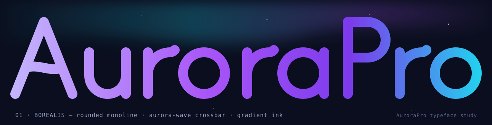
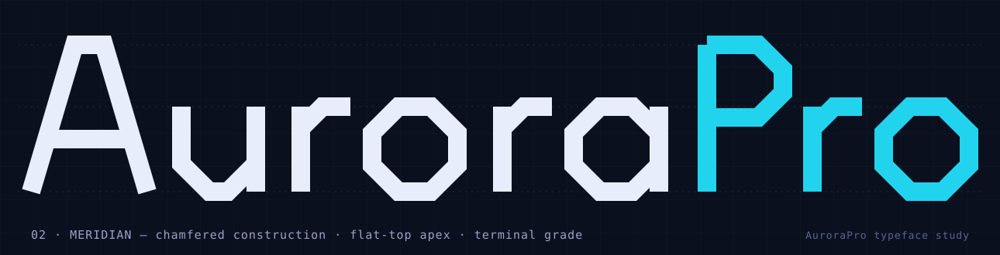
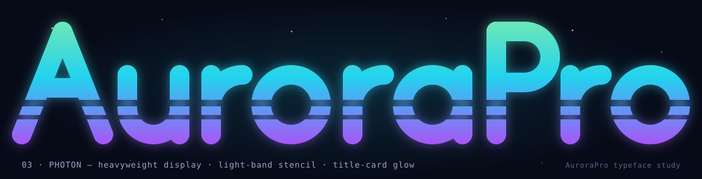

# AuroraPro typeface study — Nº 001

Three custom letterform concepts for a wordmark face called **AuroraPro**.
The nine letters of the name are hand-drawn as vector paths on one shared
skeleton (cap 190 / x-height 110 units, baseline-relative), then styled three
different ways — like three cuts of one family. No existing font is used.

> **Decision — 2026-07-30: Borealis + Photon shipped as a two-cut family.**
> Borealis is the primary wordmark (sign-in hero in gradient ink; top nav and
> companion app in flat ink), Photon the display cut (the boot splash in
> `index.html`). Both ship as drawn vector lockups via the app's
> `AuroraWordmark` component — the gradient ink, band mask, and glow that
> define these cuts are things a `.woff2` cannot carry. The README banner's
> wordmark is redrawn in Borealis paths too. Meridian remains a concept.

Open **`specimen.html`** in a browser for the full pitch (side-by-side
comparison, scale tests, the recorded decision), or view the plates directly:

## Concept 01 — Borealis · the ribbon of light

Rounded geometric monoline. The aurora lives inside the letters: the A's
crossbar is a wave mid-flutter, each r releases its arm upward, and the brand
gradient (`#C4B5FD → #A855F7 → #7C3AED → #22D3EE`) runs the length of the word.
The friendly, consumer face — app header, onboarding, README.

## Concept 02 — Meridian · signage for your own infrastructure

Chamfered octagonal construction: every curve milled to 45°, flat-top apex on
the A, butt-cut terminals, the o an octagonal cut of the play-mark aperture.
Keeps today's AURORA/PRO two-tone split (cool white / cyan). The operator's
cut — CLI banners, status page, version badges.

## Concept 03 — Photon · the title card

Heavyweight display (stroke 36) sliced by two full-width light bands, glow
leaking through the cuts; vertical green→cyan→violet ramp, the color order of
a real auroral curtain shifted onto the brand. The marquee cut — splash
screen, TV UI, launch art. Display sizes only (~40 px and up).

## Files

| File | What it is |
| --- | --- |
| `generate.mjs` | Single source of truth — emits all three SVGs and `specimen.html`. `node generate.mjs` regenerates everything. |
| `concept-0*.svg` | Standalone plates (self-contained, dark background, render on GitHub). |
| `specimen.html` | The full comparison/pitch page. |

## From mockup to font file

1. Pick a direction (or a two-cut family, e.g. Borealis + Photon for display).
2. Extend the winner beyond these nine glyphs: full lower/upper case, digits,
   punctuation.
3. Trace the outlines in FontForge (free, scriptable) and export
   `AuroraPro.woff2`.
4. Ship via `@font-face` in `static/redesign/app/src/index.css`; swap the
   header lockup in `App.tsx` and the README banner to the new face.

Implementation notes for whoever picks this up: strokes are centerline paths
(`stroke-width` 24–36) rather than filled outlines — FontForge's "Expand
Stroke" converts them; gradients use `userSpaceOnUse` because
`objectBoundingBox` is undefined on the zero-width bbox of vertical stems.
