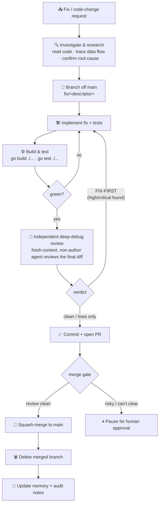

# Aurora dev workflow — fix / code-change pipeline

Every fix or code-change request follows this pipeline. The goal is that a change
is **researched before it's written, reviewed by an adversarial agent pass before
it's merged, and never merged with an unresolved high/critical finding.**



## Stages

1. **Investigate & research** — read the relevant code, trace the data flow and
   callers, and confirm the root cause before writing anything. Cite `file:line`.
2. **Branch** — never commit directly to `main`. Branch off the latest `main` as
   `fix/<short-descriptor>` (or `feat/…`, `docs/…`).
3. **Implement + tests** — make the change and add/adjust regression tests that
   would have caught the bug.
4. **Build & test gate** — `go build ./...` and `go test ./...` must be green.
   For frontend work also run `npm run audit` in `static/redesign/app/`: it builds,
   then runs six checks (focus indicators, on-art contrast, on-glass contrast,
   reduced motion, breakpoints, cascade) and a browser-driven page-alignment check.

   **That last one needs Chromium, and `npm ci` does not install it** — modern
   Playwright has no postinstall step. On a fresh machine, once:

   ```bash
   cd static/redesign/app && npx playwright install chromium
   ```

   Without it the gate fails at the final step with Playwright's own message
   telling you to run exactly that. Set `CHROMIUM_PATH` to override the binary
   before review. Loop back on failure.
5. **Independent deep-debug agent review** — dispatch a separate, fresh-context
   agent to adversarially review *the complete current diff*. The implementing
   agent's self-review does not satisfy this gate. The reviewer is read-only and
   asks: does each change actually close its issue, and did it introduce any
   regression, race, contract mismatch, lifecycle bug, or second-order failure?
   Findings cite exact file/line locations and are ordered by severity. This is
   the step that caught the H4 "permanently failed" defect in PR #146 before it
   could ship.

   Resolve every high/critical finding and independently review the resulting
   final diff again. Any substantive code change after a clean verdict invalidates
   that verdict. If no independent agent is available, mark the gate incomplete;
   never substitute or relabel a self-review.

   **Record the verdict — this gate is enforced at PUSH time, not merge time.**
   `.githooks/pre-push` (a real git hook, installed by
   `scripts/install-git-hooks.sh`) blocks the push until a record exists for
   every commit being pushed:

   ```bash
   bash scripts/record-review.sh clean --reviewer <id> --findings <n> "<summary>"
   ```

   `fix-first` records a blocking verdict; `bypass` records that no review
   happened and obliges you to report the gate as incomplete. Records are keyed
   to the exact commit, so amending or adding one invalidates them — record
   after the final commit. See CLAUDE.md for the two-layer design and its
   known limits.
6. **Merge gate** —
   - **Clean** (no unresolved high/critical; lows/nits noted) → squash-merge to
     `main` and delete the merged branch.
   - **FIX-FIRST** (high/critical found) → fix and re-review until clean.
   - **Architecturally risky / can't be cleared** → pause for human approval
     rather than auto-merge.
7. **Update notes** — record what landed and what remains in the project memory
   and the audit doc.

## Scope policy

- **Small/contained fixes** are batched into one cluster branch/PR/review cycle.
- **Architectural or breaking changes** (e.g. auth-token storage redesign,
  the root auto-updater's trust model) get their **own isolated PR** with explicit
  design notes — they are not mixed into a cluster, because their blast radius and
  rollback story are different.

_Diagram renders on GitHub and in Mermaid-aware viewers._
